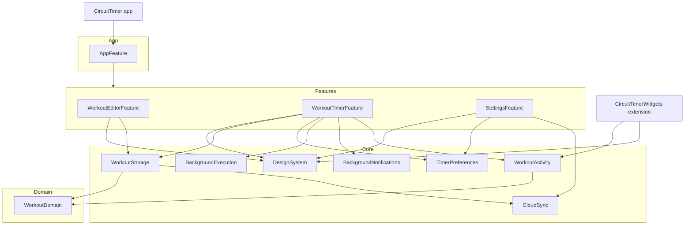

# CircuitTimer

[](https://github.com/akrementsov/CircuitTimer/actions/workflows/ci.yml)

An interval and circuit training timer for iPhone, in active development. A workout is a warm-up, a training block repeated for several rounds and a cool-down, each made of timed work and rest stages, with optional manual pauses in between.

The app has a workout list and editor backed by SwiftData, synced between the user's devices through iCloud, a full-screen timer and persistent Settings. Workouts keep their progress across backgrounding and relaunches. Foreground tones, haptics, spoken stage names and background notifications follow the Settings switches. A Live Activity shows the workout on the Lock Screen and in the Dynamic Island, with Pause/Resume controls on the card and expanded Island. See the [roadmap](#roadmap) for delivered features and remaining work.

The repository is also a showcase of how I build iOS apps: a small domain core with explicit contracts, TCA features on top, and tooling that keeps every commit green.

## Stack

- Swift 6 language mode with complete strict concurrency, iOS 17+
- SwiftUI and [The Composable Architecture](https://github.com/pointfreeco/swift-composable-architecture) 1.26 with the 2.0 deprecations trait enabled
- [swift-dependencies](https://github.com/pointfreeco/swift-dependencies) for every side effect
- Swift Testing for unit and snapshot tests; XCTest for the UI tests
- SwiftLint, GitHub Actions
- Xcode 27.1; tests run on the iOS 27.0 simulator

## Architecture

The app's code lives in one local Swift package, `CircuitTimerKit`; a second one, `CircuitTimerSnapshotKit`, holds only `SnapshotCapture` for the snapshot tests. The Xcode project is a thin shell that launches `AppFeature`, configures TipKit and installs the injected notification presentation delegate before the UI starts.

The app and its widget extension are thin targets over `CircuitTimerKit`'s modules, which form four layers; a module imports only from the layers below it:



Not drawn, to keep the picture readable: `AppFeature`, the composition root, also imports `DesignSystem`, `WorkoutStorage`, `BackgroundExecution`, `BackgroundNotifications`, `CloudSync`, `TimerPreferences`, `WorkoutActivity` and `WorkoutDomain`; the editor and the timer also import `WorkoutDomain`. Also left out are `UITestContract`, which the features and the UI tests share, and the Debug-only `AppScenarios` above the features (see [UI tests](#ui-tests)). `CircuitTimerKit/Package.swift` is the exact list.

| Module | Layer | Responsibility |
|---|---|---|
| `AppFeature` | App | The root TCA feature: the tab bar with Workouts and Settings; the workout list with loading, empty and retryable error states; pushes the workout screen onto the Workouts stack, and on Start presents the timer full screen and returns the stack to the list under it. Before the first Start it requests notification permission. At launch it offers to continue or finish a saved run while separately cleaning notifications and ending Live Activities left by the previous process. It reads the list again when iCloud brings changes from another device. |
| `WorkoutEditorFeature` | Features | The workout screen in the original app's cards: a saved workout opens read-only with Start workout at the bottom; the pencil edits a draft that the bottom Save workout button saves, back to read-only, or Back discards; a new workout starts with an empty stage in every section; stage durations typed as MM:SS on the number pad, and a dimmed Save that explains itself; stage editing within `WorkoutLimits`. |
| `WorkoutTimerFeature` | Features | The full-screen timer of the original app: a 3-2-1 countdown, the stage clock in League Gothic, progress by round, and the workout's stages on a screen of its own, opened from the timer while it pauses. Its clock loops catch wall-clock jumps against a monotonic clock, and the screen stays awake while it runs when Keep screen on is enabled. It plays generated cue tones, vibrates, and speaks stage names in the app language only while active and visible. It schedules stage-start and finish notifications for the background, in a bounded rolling window. It saves its run on every change of state; after the app was closed or killed, the list asks whether to continue it. It shows the run as a Live Activity and handles its Pause/Resume commands, with a footnote when iOS refuses an activity. |
| `SettingsFeature` | Features | The Settings tab with persistent Sound, Vibration and Speak stage names, Background notifications, Keep screen on and iCloud sync switches, with a footnote when sync is off, waits for a relaunch or does not work; its own navigation stack: About with the app version from an `AppVersionClient` dependency, and the legal pages. |
| `DesignSystem` | Core | Spacing, radius, size, typography and color tokens; clock text; the stage clock view in the bundled League Gothic; screen chrome; card rows, the caption plate and the bottom action panel; row swipe plaques and drag reorder with edge auto-scroll; the tab bar kept to the stacks' roots; the Live Activity's typography. Lint rejects literal styles anywhere else. |
| `WorkoutStorage` | Core | `WorkoutStorageClient`, a struct-of-closures dependency backed by SwiftData and mirrored to iCloud when sync is on: one copy per workout shows, the same on every device, and a deletion stays a deletion everywhere; in memory for previews. `WorkoutRunRecordClient`, the saved run as one JSON file. |
| `CloudSync` | Core | The iCloud sync switch, the launch's decision whether the store mirrors, and `CloudSyncClient`: the status of the iCloud account and of imports and exports, and the changes other devices bring. |
| `TimerPreferences` | Core | The Sound, Vibration, Speak names, Background notifications and Keep screen on toggles as `@Shared(.appStorage)` keys, shared by Settings and the timer. |
| `BackgroundExecution` | Core | `BackgroundTaskClient`: a background-task assertion around the run record writes of the timer and `AppFeature`. |
| `BackgroundNotifications` | Core | Injected local notification client, owner-scoped scheduling and cleanup, permission access, foreground suppression. |
| `WorkoutActivity` | Core | The Live Activity: a compact state of the run within iOS's 4 KB limit, what the Lock Screen and the Dynamic Island show for it, and `LiveActivityClient`, whose coordinator starts, updates and ends one activity per timer and routes owner-scoped Pause/Resume intents. The `CircuitTimerWidgets` extension draws it in the app's dark palette, with clocks that keep counting while the app sleeps. |
| `WorkoutDomain` | Domain | Workout model, normalization limits, the linear schedule and its fingerprint, and the `WorkoutRun` timer engine. Foundation and CryptoKit only, so the widget can use it. |
| `UITestContract` | Core | The accessibility identifiers the app and its UI tests share and, in Debug, the scenario names, launch keys and fixture names the tests read. No dependencies. |
| `AppScenarios` | App, Debug only | Each UI test scenario: its workouts and a value for every dependency the app reads, none of them live. The app builds its store from one when a UI test asks. |

Outside these layers, `SnapshotCapture`, in the separate package `CircuitTimerSnapshotKit`, serves only the snapshot tests and is the only code of ours that depends on SnapshotTesting: the snapshot variants, mounting a screen's root in its own window, its first frame, the bounded comparison with one fresh remount, references and the run journal. It imports none of our modules, and the app and the widget never link it (see [Snapshot tests](#snapshot-tests)).

Features never import each other, Core imports no feature, the domain imports none of our modules, and `Workout*` modules never import TCA or SwiftUI. The full set of conventions is in [AGENTS.md](AGENTS.md).

Foreground and background signal policy and the device checklist: [Timer signals](docs/timer-signals.md). How sync decides, resolves copies and deletions, what it accepts and what is checked on devices: [iCloud sync](docs/icloud-sync.md).

## The timer engine

`WorkoutRun` does not count ticks. It stores the schedule position reached at an anchor date and derives everything else from the time passed into each call:

- irregular or missed UI updates add no error; the position stays within about a millisecond of real time;
- after an hour in the background one call lands on the right stage — or on the first manual pause, which always waits for the user;
- every transition is a value-type mutation, so the whole contract is unit-testable without clocks or a UI.

The contract — a phase × operation table, nine invariants, the snapshot projection and the time rules — is written down in [docs/timer-engine.md](docs/timer-engine.md). Time is kept in whole milliseconds, and `TimeMath` is the only place that converts between `Date` and `Duration`.

### Clock changes

The engine works on wall-clock time because only a date survives an app restart and drives a Live Activity countdown.

- **Clock moved back:** the timer does not stall and committed progress is kept. If the clock goes back past the anchor the run re-anchors at the current time, and `rebase(at:keepingTotalElapsed:)` lets the UI restore the progress it has already shown.
- **Clock moved forward:** this is an accepted compromise. The run cannot tell it apart from time spent in the background, so it advances through timed stages up to the next manual pause.

### Live Activity controls

The Lock Screen card and expanded Dynamic Island have one Pause/Resume button beside the clock. Resume continues immediately, including a manual pause, and closes an open stage list or finish confirmation in the app. The initial countdown and finished card have no control; compact and minimal Island views stay read-only.

A card command targets its activity and control generation, so an older card cannot toggle a later pause. If the app process has gone, tapping ends only that orphan card: the saved run stays available for the next launch's Continue prompt. An intent waits at most five seconds for the card and notification sync; timing out does not undo a command already delivered. The run's existing background assertion protects its disk write; intent execution takes no additional assertion.

App and UI-test builds check the compiled intent metadata in both hosts, including the static-module registration needed on iOS 17.

CT-4-2 is merged. Its roadmap checkbox records delivery; the following verification limits were accepted at merge and remain open before release:

- protected Lock Screen delivery and system error presentation on a physical device;
- real process suspension at the five-second wait bound;
- runtime absence from Shortcuts and Spotlight;
- Release runtime on a physical device;
- complete system coverage of all card states, maximum text sizes, English labels and RTL.

Release simulator probes exercised card and expanded-Island Pause/Resume on iOS 17.5 and 27.0. They do not establish the physical-device checks above.

## Getting started

```sh
open CircuitTimer.xcodeproj
```

Command line, with [SwiftLint](https://github.com/realm/SwiftLint) on `PATH` and `jq` available:

| Command | What it does |
|---|---|
| `make lint` | SwiftLint in strict mode and the scenario dependency check |
| `make test-scripts` | Tests of the scripts, the make targets around xcodebuild and the custom lint rules |
| `make test` | Builds and tests the package with warnings as errors |
| `make build-app` | Builds the app for the simulator |
| `make build-ui-tests` | Builds the app with its UI tests, as `make test-ui` does |
| `make test-ui` | Builds the app and runs its UI tests on `DESTINATION` |
| `make build-snapshots` | Builds the snapshot host and tests, as `make test-snapshots` does |
| `make test-snapshot-kit` | Tests the image comparison, references, journal and environment checks without an app host |
| `make test-snapshot-contracts` | Tests capture, recording, cancellation and window cleanup in the snapshot host, separately from the PNG matrix |
| `make test-snapshots` | Compares every snapshot with its reference, in English and in Russian |
| `make record-snapshots` | Records missing references or those differing beyond the comparison bounds, on `iPhone 17` only |
| `make test-snapshot TEST=<function>` | Locally compares one snapshot variant; defaults to English and `large` text |
| `make record-snapshot TEST=<function>` | Locally records that variant if needed, then compares it again |
| `make ci` | Everything CI runs |
| `make verify-clean` | Runs `make ci` on a fresh clone of `HEAD` |

## UI tests

The UI tests in `CircuitTimerUITests` drive the app with XCUITest. Each starts the app in a named scenario, a Debug-only state with its own data and no live dependencies, and works through Screens, one struct per screen, so a test reads as the user's steps:

```swift
@MainActor
final class WorkoutTimerUITests: XCTestCase {
    func test_oneWorkout_startThenFinish_returnsToList() {
        let app = launch(.oneWorkout)

        WorkoutListScreen(app)
            .assertHasWorkout(ScenarioFixture.workoutName, duration: "2 minutes")
            .openWorkout(ScenarioFixture.workoutName)
            .tapStart()
            .assertCurrentStage("Get ready, Starting in 3")
            .tapClose()
            .tap("No")
            .assertCurrentStage("Get ready, Starting in 3")
            .tapClose()
            .tap("Finish", landingOn: WorkoutListScreen.self)
            .assertHasWorkout(ScenarioFixture.workoutName)
    }
}
```

### How to add a UI test

1. **Scenario.** Use an existing case of `AppScenario` (`UITestContract`) or add one, with its workouts in `ScenarioWorkouts.swift` and its dependencies in `AppScenario.prepare` (`AppScenarios`). `make lint` fails when a dependency client, key or storage strategy is not set there, as long as a key's declaration keeps `DependencyKey` on its first line; that the value is not live is yours to check.
2. **Identifiers.** Give the elements the test needs an identifier from `AccessibilityID`, named `<screen>.<element>`; lint rejects any other. Text the user typed, such as a workout's name, and system elements, such as an alert's buttons, are found by their text.
3. **Screen.** Add actions and checks to the screen's struct in `CircuitTimerUITests/Screens/`, or a new struct that conforms to `Screen`. Queries stay private. Every action and check takes `file: StaticString = #filePath, line: UInt = #line` and passes them to the waits and to the next screen, so a failure points at the test's line. An action returns the screen the user lands on, which waits until it shows. A screen that returns to where it came from is generic, like `AlertScreen<Source>`; behavior several screens share goes into a protocol with a default implementation.
4. **Test.** In `<Area>UITests.swift`, a `@MainActor final class` with methods named `test_<start>_<action>_<expected>`, starting with `let app = launch(.<scenario>)`. Lint rejects `sleep`, waits in tests and `XCUIApplication()` outside `launch`; keep `setUp`, if any, synchronous.
5. **Parallel safety.** A test shares nothing with other tests and depends on no order: it launches its own app. Each launch already gets its own in-memory workouts and preferences, no record, notifications or Live Activity, its own clock and identifiers. TipKit's datastore on the simulator is shared; `launch` hides tips, so a test of a tip first adds a launch option that resets the datastore and shows them.
6. **Run.** `make test-ui` runs on `iPhone 17`; another simulator takes its own result bundle, log and DerivedData, for example `make test-ui DESTINATION='platform=iOS Simulator,name=iPhone 17 #2,OS=27.0'`. Runs on two simulators may overlap only after one run on each has finished alone; each first run is a cold build and its DerivedData takes several GB. `scripts/report-test-results.sh .build/TestResults/*.xcresult` prints failures, flaky tests and the slowest tests. More than one Xcode worker (`UI_TEST_WORKERS`) runs only on CI.
7. **Time stands still.** A scenario's clock never advances, so a started timer stays on its first countdown digit. The timer's logic is tested in the package with `TestStore` and `TestClock`.

## Snapshot tests

The capture harness has its own tests: `make test-snapshot-kit` runs the package tests, and
`make test-snapshot-contracts` runs `CircuitTimerSnapshotContractTests` inside the empty snapshot host.
Contract tests use temporary synthetic references and do not change the screen references below. Serialize these two commands manually per checkout, including across simulator destinations: temporary reference directories are shared between those processes. Generated contract PNGs are ignored if a process is interrupted. The dedicated ru/de runs must execute their selected language test without skipping it.
`make test-scripts` also checks the snapshot runner and make targets using fixture result bundles.

`CircuitTimerSnapshotTests` compares screens of the app with reference PNGs. A test describes a screen by its state — the stack, the editor's phase, the data — not by the taps that lead there. The host draws the whole app in that state in a window of iPhone 17's size and compares its first frame with a reference PNG. Drawing and comparing live in `SnapshotCapture`, in the local package `CircuitTimerSnapshotKit`, the only code of ours that depends on SnapshotTesting; what the app's states look like lives in the test target.

```swift
extension SnapshotTests {
    @MainActor
    @Suite
    struct WorkoutEditorSnapshotTests {
        @Test(arguments: SnapshotTextSize.currentCases())
        func test_editor_editing_matchesReference(textSize: SnapshotTextSize) async throws {
            try await assertAppSnapshot(textSize: textSize) { language in
                .editing(SnapshotFixtures.editorWorkout(language: language))
            }
        }
    }
}
```

Both images are normalized to 8-bit sRGB for comparison. Their dimensions and alpha bytes must match exactly. RGB channels may differ by at most 2/255 on at most 1.25% of the pixels; exceeding either limit fails the test. These bounds cover the measured host-dependent edge and glass rendering differences. The same criterion applies to both mounts; PNG recording keeps the renderer's original output.

### How to add a snapshot

1. **State.** Build the `AppFeature.State` the screen shows once its transitions have finished, with a factory in `Support/AppFeature+SnapshotStates.swift` (`list`, `failedList`, `viewing`, `editing`) or a new one there. Set the Workouts stack's `path` and the editor's `phase` directly; `@testable import` reaches their internal setters. Never `send` actions to get there. Data comes from `SnapshotFixtures`, in the language the closure receives. The closure runs once per mount, inside the snapshot's dependencies, so it must build the same state every time. Link any new product imported by shared `Support/` into both `CircuitTimerSnapshotTests` and `CircuitTimerSnapshotContractTests`.
2. **Test.** One test function per state, in `<Area>SnapshotTests.swift` inside `extension SnapshotTests`, named `test_<screen>_<state>_matchesReference` and unique across the snapshot tests. It always takes text sizes as its arguments: `SnapshotTextSize.currentCases()` (`large`, `ax5`), or `SnapshotTextSize.currentCases(in: [.large])` where the largest text adds nothing. Keep this `@Test` declaration on one line, using one of these two forms, so the run check can enumerate the expected sizes. Call `assertAppSnapshot(textSize:)` once.
3. **Language.** Every snapshot runs in English and in Russian: `make test-snapshots` starts four test processes, one per language and text size. A Russian process breaks lines differently from Russian strings in an English one, and UIKit fonts read the process's preferred text size. The scheme passes `-UIPreferredContentSizeCategoryName` from `SNAPSHOT_CONTENT_SIZE_CATEGORY`; `SNAPSHOT_TEXT_SIZE` selects the test arguments. The capture checks that the actual process category matches its argument before building the screen. Narrow a run only with `SNAPSHOT_LANGUAGES=en` or `ru`; flags that select or repeat tests are refused. The app is dark only.
4. **Record.** `make record-snapshots` on `iPhone 17` / iOS 27.0, with no uncommitted change under `CircuitTimerSnapshotTests/__Snapshots__`. It writes the references that are missing or differ beyond the comparison bounds, leaves matching references untouched (including differences within the bounds), compares everything again and lists the new references: check that your test's appear. References are `__Snapshots__/<test file>/<test function>.<language>-<size>.png`. If the final comparison fails, run `git restore` and `git clean -f` on that folder and record again. A reference that does not load or has the wrong size fails its test. Replacing an invalid reference or intentionally replacing one accepted within the bounds requires removing its PNG in a reviewed commit before recording the replacement; the reference folder must be clean when recording starts.
5. **Review.** Open every new or changed PNG and say in the pull request why it changed. Delete the references of a test you rename or remove: a reference no test checks fails the run. `make test-snapshots` and CI never write references; a failure keeps the actual image in `.build/TestResults/Snapshots-<run>-<language>-<size>-artifacts/<test file>/`, with `<run>` as for `make test-ui`, and, when the image strategy can produce them, the reference, failure and difference images in the result bundle. A normalization error or a failure for which the strict strategy supplies no attachments can leave only the failure text there.
6. **Effects.** Dependencies are the test context's, except what `Support/SnapshotDependencies.swift` sets. These are rendering tests, not exhaustive effect tests. Unconfigured dependency endpoints keep their test values; a passing snapshot does not prove that no effects ran. TipKit is not configured in the host, so no tip shows.

### Work on one snapshot

While adding or changing a screen, select its test function without the suite name or `(textSize:)`:

```sh
make test-snapshot TEST=test_editor_editing_matchesReference
make record-snapshot TEST=test_editor_editing_matchesReference \
  SNAPSHOT_LANGUAGE=ru SNAPSHOT_TEXT_SIZE=ax5
```

`SNAPSHOT_LANGUAGE` is `en` (default) or `ru`; `SNAPSHOT_TEXT_SIZE` is `large` (default) or `ax5`. Use the singular `SNAPSHOT_LANGUAGE` here; the plural `SNAPSHOT_LANGUAGES` belongs to the full-matrix commands and is rejected by the single-snapshot commands. The function must exist exactly once inside an explicitly annotated `@Suite` in the screen snapshot sources and support that size. The command fails if the selected case does not run, skips, or runs alongside another case. Result bundles and artifacts use the `Snapshot-<run>-<function>-<language>-<size>` prefix, separate from the full matrix.

These commands are local only. Comparison accepts the same simulators as `make test-snapshots`; recording requires `iPhone 17` / iOS 27.0 and a clean reference folder, as `make record-snapshots` does. Recording writes only the selected missing or out-of-bounds reference, then runs that comparison in `never` mode. Review the changed PNG before committing it. The reference folder must be clean before each recording command; use `make record-snapshots` when adding several variants of a new test. Before submitting a change, run the full `make test-snapshots` matrix; CI always checks all applicable cases.

The timer's full-screen cover does not draw in the first frame, so the host fails a state that presents it. The timer snapshots will describe a `WorkoutTimerFeature.State` and draw `WorkoutTimerStack` as the window's root: with the timer's reducer replaced by `EmptyReducer`, that root was measured to match the presented cover in every variant; with the real reducer it is not measured yet. Alerts and dialogs are not supported yet. Snapshots run only on iOS 27.0 with iPhone 17's screen. They do not cover how the tab bar leaves on a push (`TabBarRidesWithRoot`).

## Releasing

1. For a new version, bump `MARKETING_VERSION` through a pull request. Wait for CI on `main` to pass.
2. If the CloudKit schema changed, create it in Development and deploy it to Production first ([iCloud sync](docs/icloud-sync.md#signing-and-delivery)).
3. Tag the commit `vX.Y.Z`, or `vX.Y.Z-rc.N` for another build of the same version, and push the tag.
4. The TestFlight workflow archives the app, signs it in the cloud with an App Store Connect API key and uploads it. The build is available once App Store Connect finishes processing it.

## Roadmap

Next: CT-11, a HealthKit workout session. Checked milestones record delivered functionality; the device checks under CT-7 remain open before release.

- [x] **CT-1 Foundation** — package, domain model, schedule, timer engine, design tokens, root feature, lint and CI
- [x] **CT-8 Delivery** — TestFlight builds from GitHub Actions: a `v*` tag on `main` archives, signs in the cloud and uploads; the first build, 0.1.0, went through on 2026-10-14
- [x] **CT-2** — workout list and editor, SwiftData persistence
- [x] **CT-UI** — dark design of the original app, in slices:
  - [x] **CT-UI-1** — dark design tokens and the launch screen
  - [x] **CT-UI-2** — workout list after the original screen; the system navigation bar, Liquid Glass on iOS 26
  - [x] **CT-UI-3** — tab bar and the Settings tab with About and legal-page navigation; legal texts remain in CT-7
  - [x] **CT-UI-4** — the editor pushed onto the Workouts stack, with its own back button and no back gestures
  - [x] **CT-UI-5** — editor layout of the original app
  - [x] **CT-UI-6** — stage durations typed as MM:SS
  - [x] Swipe actions of the original app: the delete plaque on editor stages and on the list, duplicate on the list; own drag reorder (delivered with CT-3-2)
- [x] **CT-10** — a horizontal swipe on a tab's root switches to the neighbouring tab, as a tap on it would
- [x] **CT-QA** — tests through the UI, in slices:
  - [x] **CT-QA-1** — UI test architecture: Debug-only launch scenarios with no live dependencies, Screens, a shared test harness and CI step, and two tests that prove it
  - [x] UI smoke tests: empty list, creating and saving a workout, workout and stage reorder, starting and closing the timer
  - [x] UI smoke test: edit an existing workout, save it and verify the changes in the list and reopened editor
  - [x] UI smoke tests: all five Settings switches in both directions and after returning to the tab; About version and navigation to both legal pages
  - [x] **CT-QA-2** — snapshot tests of the list and editor (dark only, English and Russian, Dynamic Type)
- [x] **CT-3** — the workout timer, in slices:
  - [x] **CT-3-1** — the timer in the foreground: full screen from the list, countdowns, clock-jump handling, the screen kept awake
  - [x] **CT-3-2** — the original start path: the workout screen and its Start workout button
  - [x] **CT-3-3** — background and restore
  - [x] **CT-3-4** — sound, haptics, spoken stage names and the Settings toggles
  - [x] **CT-3-5** — cues in the background through local notifications
- [x] **CT-4** — Live Activity and Dynamic Island, in slices (remaining system checks are listed [above](#live-activity-controls)):
  - [x] **CT-4-1** — the running workout on the Lock Screen and in the Dynamic Island, and signing checks of both bundles on TestFlight
  - [x] **CT-4-2** — pause and resume from the Live Activity
- [x] **CT-5** — iCloud sync of workouts, with a Settings switch and a footnote when iCloud is unavailable (its [device checklist](docs/icloud-sync.md#device-checklist) is listed under CT-7)
- [ ] **CT-6** — in-app purchase with StoreKit 2
- [ ] **CT-7** — App Store release
  - [ ] Write the Privacy Policy and User Agreement in English and Russian; both pages are currently empty and must be filled before the first external build
  - [ ] Complete the [foreground signal device checklist](docs/timer-signals.md#device-checklist): audio mixing and interruptions, speech, VoiceOver and haptics
  - [ ] Complete the [background notification device checks](docs/timer-signals.md#background-notifications): permission flows, locked-screen delivery, manual pauses, relaunch cleanup and the rolling-window limits
  - [ ] Complete the remaining [Live Activity system checks](#live-activity-controls), including Release on a physical device
  - [ ] Complete the [iCloud sync device checklist](docs/icloud-sync.md#device-checklist) on two iPhones, iOS 17 and 26.5
- [ ] **CT-9** — Apple Watch app
- [ ] **CT-11** — a HealthKit workout session on iOS 26 and later, so that a workout keeps running in the background and closing the app ends its Live Activity and notifications; finished workouts saved to Health

## License

© Andrey Krementsov. All rights reserved. The code is published for review purposes only; no license to use, copy or distribute it is granted.
