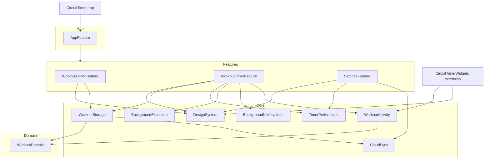

# CircuitTimer

[](https://github.com/akrementsov/CircuitTimer/actions/workflows/ci.yml)

An interval and circuit training timer for iPhone, in active development. A workout is a warm-up, a training block repeated for several rounds and a cool-down, each made of timed work and rest stages, with optional manual pauses in between.

The app has a workout list and editor backed by SwiftData, synced between the user's devices through iCloud, a full-screen timer and persistent Settings. Workouts keep their progress across backgrounding and relaunches. Foreground tones, haptics, spoken stage names and background notifications follow the Settings switches. A Live Activity shows the workout on the Lock Screen and in the Dynamic Island, with Pause/Resume controls on the card and expanded Island. Delivered milestones, what comes next and the release checklist are in the [roadmap](docs/roadmap.md).

The repository is also a showcase of how I build iOS apps: a small domain core with explicit contracts, TCA features on top, and tooling that keeps every commit green.

## Stack

- Swift 6 language mode with complete strict concurrency, iOS 17+
- SwiftUI and [The Composable Architecture](https://github.com/pointfreeco/swift-composable-architecture) 1.26 with the 2.0 deprecations trait enabled
- [swift-dependencies](https://github.com/pointfreeco/swift-dependencies) for every side effect
- Swift Testing for unit and snapshot tests; XCTest for the UI tests
- SwiftLint, GitHub Actions
- Xcode 27.1; tests run on the iOS 27.0 simulator

## Architecture

The app's code lives in one local Swift package, `CircuitTimerKit`; a second one, `CircuitTimerSnapshotKit`, holds only `SnapshotCapture` for the snapshot tests. The Xcode project is a thin shell that launches `AppFeature`, configures TipKit and installs the injected notification presentation delegate before the UI starts.

The app and its widget extension are thin targets over `CircuitTimerKit`'s modules, which form four layers; a module imports only from the layers below it:



Not drawn, to keep the picture readable: `AppFeature`, the composition root, also imports `DesignSystem`, `WorkoutStorage`, `BackgroundExecution`, `BackgroundNotifications`, `CloudSync`, `TimerPreferences`, `WorkoutActivity` and `WorkoutDomain`; the editor and the timer also import `WorkoutDomain`. Also left out are `UITestContract`, which the features and the UI tests share, and the Debug-only `AppScenarios` above the features (see [UI tests](#ui-tests)). `CircuitTimerKit/Package.swift` is the exact list.

| Module | Layer | Responsibility |
|---|---|---|
| `AppFeature` | App | The root TCA feature: the tab bar with Workouts and Settings; the workout list with loading, empty and retryable error states; pushes the workout screen onto the Workouts stack, and on Start presents the timer full screen and returns the stack to the list under it. Before the first Start it requests notification permission. At launch it offers to continue or finish a saved run while separately cleaning notifications and ending Live Activities left by the previous process. It reads the list again when iCloud brings changes from another device. |
| `WorkoutEditorFeature` | Features | The workout screen in the original app's cards: a saved workout opens read-only with Start workout at the bottom; the pencil edits a draft that the bottom Save workout button saves, back to read-only, or Back discards; a new workout starts with an empty stage in every section; stage durations typed as MM:SS on the number pad, and a dimmed Save that explains itself; stage editing within `WorkoutLimits`. |
| `WorkoutTimerFeature` | Features | The full-screen timer of the original app: a 3-2-1 countdown, the stage clock in League Gothic, progress by round, and the workout's stages on a screen of its own, opened from the timer while it pauses. Its clock loops catch wall-clock jumps against a monotonic clock, and the screen stays awake while it runs when Keep screen on is enabled. It plays generated cue tones, vibrates, and speaks stage names in the app language only while active and visible. It schedules stage-start and finish notifications for the background, in a bounded rolling window. It saves its run on every change of state; after the app was closed or killed, the list asks whether to continue it. It shows the run as a Live Activity and handles its Pause/Resume commands, with a footnote when iOS refuses an activity. |
| `SettingsFeature` | Features | The Settings tab with persistent Sound, Vibration and Speak stage names, Background notifications, Keep screen on and iCloud sync switches, with a footnote when sync is off, waits for a relaunch or does not work; its own navigation stack: About with the app version from an `AppVersionClient` dependency, and the legal pages. |
| `DesignSystem` | Core | Spacing, radius, size, typography and color tokens; clock text; the stage clock view in the bundled League Gothic; screen chrome; card rows, the caption plate and the bottom action panel; row swipe plaques and drag reorder with edge auto-scroll; the tab bar kept to the stacks' roots; the Live Activity's typography. Lint rejects literal styles anywhere else. |
| `WorkoutStorage` | Core | `WorkoutStorageClient`, a struct-of-closures dependency backed by SwiftData and mirrored to iCloud when sync is on: one copy per workout shows, the same on every device, and a deletion stays a deletion everywhere; in memory for previews. `WorkoutRunRecordClient`, the saved run as one JSON file. |
| `CloudSync` | Core | The iCloud sync switch, the launch's decision whether the store mirrors, and `CloudSyncClient`: the status of the iCloud account and of imports and exports, and the changes other devices bring. |
| `TimerPreferences` | Core | The Sound, Vibration, Speak names, Background notifications and Keep screen on toggles as `@Shared(.appStorage)` keys, shared by Settings and the timer. |
| `BackgroundExecution` | Core | `BackgroundTaskClient`: a background-task assertion around the run record writes of the timer and `AppFeature`. |
| `BackgroundNotifications` | Core | Injected local notification client, owner-scoped scheduling and cleanup, permission access, foreground suppression. |
| `WorkoutActivity` | Core | The Live Activity: a compact state of the run within iOS's 4 KB limit, what the Lock Screen and the Dynamic Island show for it, and `LiveActivityClient`, whose coordinator starts, updates and ends one activity per timer and routes owner-scoped Pause/Resume intents. The `CircuitTimerWidgets` extension draws it in the app's dark palette, with clocks that keep counting while the app sleeps. |
| `WorkoutDomain` | Domain | Workout model, normalization limits, the linear schedule and its fingerprint, and the `WorkoutRun` timer engine. Foundation and CryptoKit only, so the widget can use it. |
| `UITestContract` | Core | The accessibility identifiers the app and its UI tests share and, in Debug, the scenario names, launch keys and fixture names the tests read. No dependencies. |
| `AppScenarios` | App, Debug only | Each UI test scenario: its workouts and a value for every dependency the app reads, none of them live. The app builds its store from one when a UI test asks. |

Outside these layers, `SnapshotCapture`, in the separate package `CircuitTimerSnapshotKit`, serves only the snapshot tests and is the only code of ours that depends on SnapshotTesting: the snapshot variants, mounting a screen's root in its own window, its first frame, the bounded comparison with one fresh remount, references and the run journal. It imports none of our modules, and the app and the widget never link it (see [Snapshot tests](#snapshot-tests)).

Features never import each other, Core imports no feature, the domain imports none of our modules, and `Workout*` modules never import TCA or SwiftUI. The full set of conventions is in [AGENTS.md](AGENTS.md).

Foreground and background signal policy and the device checklist: [Timer signals](docs/timer-signals.md). How sync decides, resolves copies and deletions, what it accepts and what is checked on devices: [iCloud sync](docs/icloud-sync.md).

## The timer engine

`WorkoutRun` does not count ticks. It stores the schedule position reached at an anchor date and derives everything else from the time passed into each call:

- irregular or missed UI updates add no error; the position stays within about a millisecond of real time;
- after an hour in the background one call lands on the right stage — or on the first manual pause, which always waits for the user;
- every transition is a value-type mutation, so the whole contract is unit-testable without clocks or a UI.

The contract — a phase × operation table, nine invariants, the snapshot projection and the time rules — is written down in [docs/timer-engine.md](docs/timer-engine.md). Time is kept in whole milliseconds, and `TimeMath` is the only place that converts between `Date` and `Duration`.

### Clock changes

The engine works on wall-clock time because only a date survives an app restart and drives a Live Activity countdown.

- **Clock moved back:** the timer does not stall and committed progress is kept. If the clock goes back past the anchor the run re-anchors at the current time, and `rebase(at:keepingTotalElapsed:)` lets the UI restore the progress it has already shown.
- **Clock moved forward:** this is an accepted compromise. The run cannot tell it apart from time spent in the background, so it advances through timed stages up to the next manual pause.

## Live Activity

The running workout shows on the Lock Screen and in the Dynamic Island: the current stage with its clock and the next stage, in the app's dark palette. The card and the expanded Island have one Pause/Resume button beside the clock. How the controls work and the checks still open on a device: [Live Activity](docs/live-activity.md).

## Getting started

```sh
open CircuitTimer.xcodeproj
```

Command line, with [SwiftLint](https://github.com/realm/SwiftLint) on `PATH` and `jq` available:

| Command | What it does |
|---|---|
| `make lint` | SwiftLint in strict mode and the scenario dependency check |
| `make test-scripts` | Tests of the scripts, the make targets around xcodebuild and the custom lint rules |
| `make test` | Builds and tests the package with warnings as errors |
| `make build-app` | Builds the app for the simulator |
| `make test-ui` | Builds the app and runs its UI tests on `DESTINATION` |
| `make test-snapshots` | Compares every snapshot with its reference, in English and in Russian |
| `make ci` | Everything CI runs |
| `make verify-clean` | Runs `make ci` on a fresh clone of `HEAD` |

Test commands for one area or one snapshot: [Testing](docs/testing.md#commands). Every target: [AGENTS.md](AGENTS.md) › Essential commands.

## Testing

### UI tests

The UI tests in `CircuitTimerUITests` drive the app with XCUITest. Each starts the app in a named scenario, a Debug-only state with its own data and no live dependencies, and works through Screens, one struct per screen, so a test reads as the user's steps:

```swift
@MainActor
final class WorkoutTimerUITests: XCTestCase {
    func test_oneWorkout_startThenFinish_returnsToList() {
        let app = launch(.oneWorkout)

        WorkoutListScreen(app)
            .assertHasWorkout(ScenarioFixture.workoutName, duration: "2 minutes")
            .openWorkout(ScenarioFixture.workoutName)
            .tapStart()
            .assertCurrentStage("Get ready, Starting in 3")
            .tapClose()
            .tap("No")
            .assertCurrentStage("Get ready, Starting in 3")
            .tapClose()
            .tap("Finish", landingOn: WorkoutListScreen.self)
            .assertHasWorkout(ScenarioFixture.workoutName)
    }
}
```

How to add one, step by step: [How to add a UI test](docs/testing.md#how-to-add-a-ui-test).

### Snapshot tests

`CircuitTimerSnapshotTests` compares screens of the app with reference PNGs. A test describes a screen by its state — the stack, the editor's phase, the data — not by the taps that lead there. The host draws the whole app in that state in a window of iPhone 17's size and compares its first frame with a reference PNG. Drawing and comparing live in `SnapshotCapture`, in the local package `CircuitTimerSnapshotKit`, the only code of ours that depends on SnapshotTesting; what the app's states look like lives in the test target.

Six states — the workout list, the workout screen and Settings — are compared in English and in Russian; three of them also at the largest accessibility text size, 18 references in all. Two images match when RGB channels differ by at most 2/255 on at most 1.25% of the pixels. The timer's cover and alerts are not drawn. The example, how to add a snapshot and how to work on one: [Snapshot tests](docs/testing.md#snapshot-tests).

## Releasing

1. For a new version, bump `MARKETING_VERSION` through a pull request. Wait for CI on `main` to pass.
2. If the CloudKit schema changed, create it in Development and deploy it to Production first ([iCloud sync](docs/icloud-sync.md#signing-and-delivery)).
3. Tag the commit `vX.Y.Z`, or `vX.Y.Z-rc.N` for another build of the same version, and push the tag.
4. The TestFlight workflow archives the app, signs it in the cloud with an App Store Connect API key and uploads it. The build is available once App Store Connect finishes processing it.

## License

© Andrey Krementsov. All rights reserved. The code is published for review purposes only; no license to use, copy or distribute it is granted.
