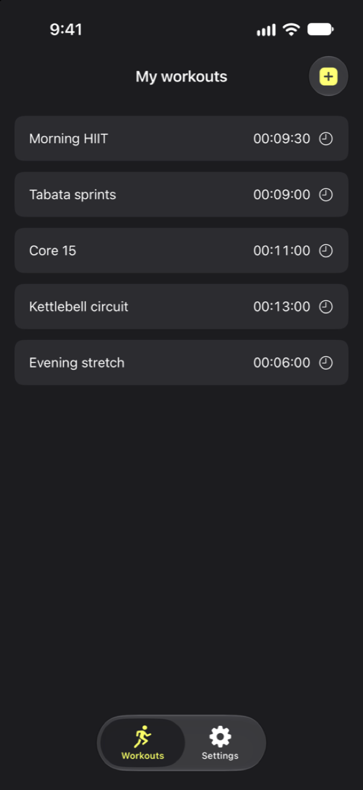
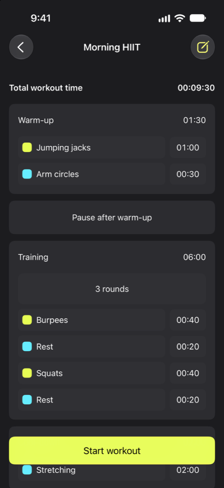
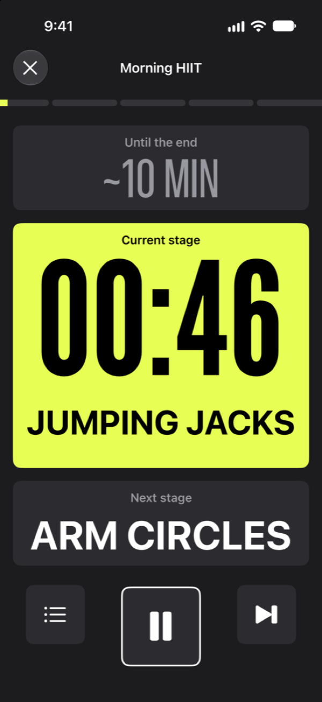
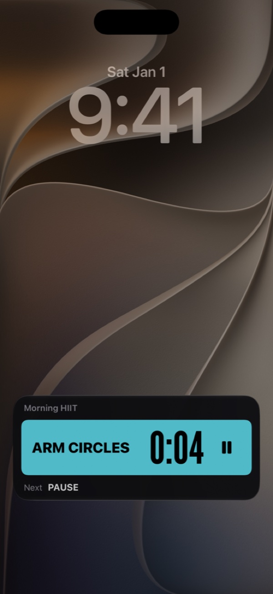
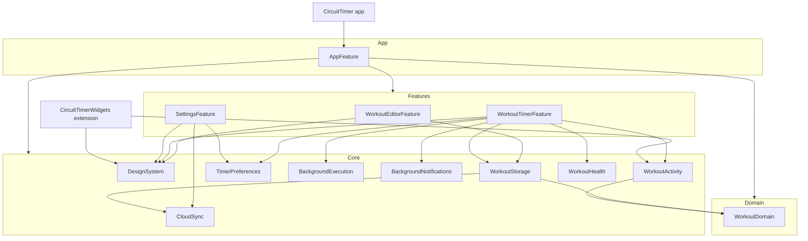

# CircuitTimer

[](https://github.com/akrementsov/CircuitTimer/actions/workflows/ci.yml)

An interval and circuit training timer for iPhone. A workout is a warm-up, a training block repeated for several rounds and a cool-down, each made of timed work and rest stages, with optional manual pauses in between. Internal builds go out through TestFlight; an App Store release is planned.

<p>
  
  
  
  
</p>

- A workout list and editor, stored with SwiftData and synced between the user's devices through iCloud.
- A full-screen timer that keeps its progress across backgrounding and relaunches.
- Tones, haptics, spoken stage names and background notifications, each with its own switch in Settings.
- A Live Activity on the Lock Screen and in the Dynamic Island, with Pause/Resume on the card.
- A swipe on a tab's root switches tabs; the interface is in English and Russian.

The repository is also a showcase of how I build iOS apps: a small domain core with explicit contracts, TCA features on top, and tooling that keeps every commit green. Delivered milestones, what comes next and the release checklist are in the [roadmap](docs/roadmap.md).

## Where to look

- **The timer engine.** `WorkoutRun` derives the position from time instead of counting ticks: [The timer engine](#the-timer-engine) and [Timer engine contract](docs/timer-engine.md).
- **Feature boundaries.** TCA features that never import each other, composed in one root: [Architecture](#architecture) and [AGENTS.md](AGENTS.md).
- **The Live Activity.** Pause/Resume from the Lock Screen and the Dynamic Island; a command from an outdated card is ignored: [Live Activity](docs/live-activity.md).
- **iCloud sync.** One visible copy per workout on every device, deletions that stay deleted: [iCloud sync](docs/icloud-sync.md).
- **Tests.** Unit, UI and snapshot tests, and `make verify-clean` before every merge: [Testing](#testing).

## Stack

- Swift 6 language mode with complete strict concurrency, iOS 17+
- SwiftUI and [The Composable Architecture](https://github.com/pointfreeco/swift-composable-architecture) 1.26 with the 2.0 deprecations trait enabled
- [swift-dependencies](https://github.com/pointfreeco/swift-dependencies) for every side effect, [swift-sharing](https://github.com/pointfreeco/swift-sharing) for preferences
- SwiftData mirrored to CloudKit; ActivityKit and App Intents for the Live Activity; TipKit
- Swift Testing for unit and snapshot tests, [SnapshotTesting](https://github.com/pointfreeco/swift-snapshot-testing) for the images; XCTest for the UI tests
- SwiftLint, GitHub Actions
- Xcode 27.1; tests run on the iOS 27.0 simulator

## Getting started

### Requirements

- Xcode 27.1. The tests and the run block below use an `iPhone 17` simulator on iOS 27.0.
- [SwiftLint](https://github.com/realm/SwiftLint) for `make lint`; CI runs 0.65.1. Pass `SWIFTLINT=<path>` if it is not on `PATH`.
- `jq` and `python3`: the test, snapshot and build targets use them; the run block below uses `jq`.

### Run the app

Open `CircuitTimer.xcodeproj` to read the code. The `CircuitTimer` scheme signs with the owner's team and iCloud container (`Configs/App.xcconfig`, `Configs/CircuitTimer.entitlements`), so running it from Xcode is set up for that team only.

Anyone can build the app unsigned for the simulator. Such a build has no CloudKit container, so workouts stay on the device and Settings reports a failed sync. From the repository root, build, then run the block; it is safe to repeat and stops at the first error:

```sh
make build-app
```

```sh
(
  set -e
  devices=$(xcrun simctl list devices available -j)
  if udid=$(printf '%s\n' "$devices" | jq -er \
    'first(.devices["com.apple.CoreSimulator.SimRuntime.iOS-27-0"][]? | select(.name == "iPhone 17") | .udid)'); then
    xcrun simctl bootstatus "$udid" -b
    open "$(xcode-select -p)/../Applications/DeviceHub.app"
    xcrun simctl install "$udid" .build/DerivedData/App/Build/Products/Debug-iphonesimulator/CircuitTimer.app
    xcrun simctl launch --terminate-running-process "$udid" com.akrementsov.circuittimer
  else
    echo "No iPhone 17 simulator on iOS 27.0: add one in Device Hub." >&2
    exit 1
  fi
)
```

In Xcode 27.1 Device Hub takes the place of Simulator.app; if several simulators are booted, choose `iPhone 17` on iOS 27.0 in it. The block is pinned to the tests' runtime, which a fresh Xcode may need to download in Xcode › Settings › Components. Any simulator on iOS 17 or later also runs the app: change the runtime key and the device name in the block.

### Commands

| Command | What it does |
|---|---|
| `make lint` | SwiftLint in strict mode and the scenario dependency check |
| `make test-scripts` | Tests of the scripts, the make targets around xcodebuild and the custom lint rules |
| `make test` | Builds and tests the package with warnings as errors |
| `make build-app` | Builds the app for the simulator |
| `make test-ui` | Builds the app and runs its UI tests on `DESTINATION` |
| `make test-snapshots` | Compares every snapshot with its reference, in English and in Russian |
| `make ci` | Everything CI runs |
| `make verify-clean` | Runs `make ci` on a fresh clone of `HEAD` |

Test commands for one area or one snapshot: [Testing guide › Commands](docs/testing.md#commands). The full command reference: [AGENTS.md › Essential commands](AGENTS.md#essential-commands).

## Architecture

The app's code lives in one local Swift package, `CircuitTimerKit`; a second one, `CircuitTimerSnapshotKit`, holds only `SnapshotCapture` for the snapshot tests. The app and its widget extension are thin targets over the package's modules.

The modules form four layers. A module imports only from its own layer or the layers below, except that the screen features never import each other; `AppFeature` composes them.



Not drawn: the editor and the timer also import `WorkoutDomain`; `UITestContract` and the Debug-only `AppScenarios` are left out. The exact lists are `CircuitTimerKit/Package.swift` and, for the app and the widget, [AGENTS.md › Module map](AGENTS.md#module-map).

| Module | Responsibility |
|---|---|
| `AppFeature` | Tab bar, the workout list (loading, empty, retryable error), navigation, restoring a saved run, the teardown when iOS terminates the app |
| `WorkoutEditorFeature` | The workout screen: read-only with Start, or a draft saved or discarded whole; an empty stage per section of a new workout; stage durations as MM:SS on the number pad |
| `WorkoutTimerFeature` | The full-screen timer: countdowns, progress by round, cues, background notifications, the saved run, the Live Activity, a Health workout session on iOS 26 and later |
| `SettingsFeature` | The signal, Keep screen on and iCloud sync switches; About with the version from `AppVersionClient`; legal pages |
| `DesignSystem` | Tokens, the League Gothic stage clock, cards, the caption plate, swipe plaques and drag reorder |
| `WorkoutStorage` | `WorkoutStorageClient` (struct of closures, in memory for previews): SwiftData mirrored to iCloud when sync is on; the saved run file |
| `CloudSync` | The sync switch, the launch's mirroring decision, account and import/export status |
| `TimerPreferences` | The signal and Keep screen on switches, shared by Settings and the timer |
| `BackgroundExecution` | Background-task assertions around the saved run's writes |
| `BackgroundNotifications` | Owner-scoped local notifications, permission access, foreground suppression |
| `WorkoutActivity` | The Live Activity's state, its Lock Screen and Island content, Pause/Resume intents; drawn by `CircuitTimerWidgets` |
| `WorkoutHealth` | Health access and, on iOS 26 and later, the workout session that keeps a running timer's app alive, so closing it removes the card and notifications |
| `WorkoutDomain` | The workout model, limits, the schedule and the `WorkoutRun` engine; Foundation and CryptoKit only, so `WorkoutActivity` and the widget can link it |
| `UITestContract` | Below the features, no dependencies: accessibility identifiers and the UI tests' launch names |
| `AppScenarios` | Debug only, above the features: each UI test scenario's data and non-live dependencies |

`SnapshotCapture` is the only code of ours that depends on SnapshotTesting; it imports none of our modules, and the app and the widget never link it. Core imports no feature, the domain imports none of our modules, and `WorkoutDomain`, `WorkoutStorage` and `WorkoutActivity` never import TCA or SwiftUI. Full rules: [AGENTS.md](AGENTS.md).

Foreground and background signal policy and the device checklist: [Timer signals](docs/timer-signals.md). How sync decides, resolves copies and deletions, what it accepts and what is checked on devices: [iCloud sync](docs/icloud-sync.md).

## The timer engine

`WorkoutRun` does not count ticks. It stores the schedule position reached at an anchor date and derives everything else from the time passed into each call:

- irregular or missed UI updates add no error; the position stays within about a millisecond of real time;
- after an hour in the background one call lands on the right stage — or on the first manual pause, which always waits for the user;
- every transition is a value-type mutation, so the whole contract is unit-testable without clocks or a UI.

The contract — a phase × operation table, nine invariants, the snapshot projection and the time rules — is written down in [docs/timer-engine.md](docs/timer-engine.md). Time is kept in whole milliseconds, and `TimeMath` is the only place that converts between `Date` and `Duration`.

### Clock changes

The engine works on wall-clock time, because only a date survives an app restart and drives a Live Activity countdown. A clock moved back never stalls the timer or loses committed progress; a clock moved forward counts as time spent in the background. Details: [Clock changes](docs/timer-engine.md#clock-changes).

## Live Activity

The running workout shows on the Lock Screen and in the Dynamic Island: the current stage with its clock and the next stage, in the app's dark palette. The card and the expanded Island have one Pause/Resume button beside the clock. How the controls work and the checks still open on a device: [Live Activity](docs/live-activity.md).

## Testing

Unit tests use Swift Testing, with `TestStore` and `TestClock` for the features; UI tests use XCTest; snapshot tests, Swift Testing with SnapshotTesting. Adding a UI test or a snapshot, and commands for one area: [Testing guide](docs/testing.md).

### UI tests

The UI tests in `CircuitTimerUITests` drive the app with XCUITest. Each starts the app in a named scenario, a Debug-only state with its own data and no live dependencies, and works through Screens, one struct per screen, so a test reads as the user's steps:

```swift
@MainActor
final class WorkoutTimerUITests: XCTestCase {
    func test_oneWorkout_startThenFinish_returnsToList() {
        let app = launch(.oneWorkout)

        WorkoutListScreen(app)
            .assertHasWorkout(ScenarioFixture.workoutName, duration: "2 minutes")
            .openWorkout(ScenarioFixture.workoutName)
            .tapStart()
            .assertCurrentStage("Get ready, Starting in 3")
            .tapClose()
            .tap("No")
            .assertCurrentStage("Get ready, Starting in 3")
            .tapClose()
            .tap("Finish", landingOn: WorkoutListScreen.self)
            .assertHasWorkout(ScenarioFixture.workoutName)
    }
}
```

How to add one, step by step: [How to add a UI test](docs/testing.md#how-to-add-a-ui-test).

### Snapshot tests

`CircuitTimerSnapshotTests` describes a screen by its state — the stack, the editor's phase, the data — not by the taps that lead there. The host draws the whole app in that state in a window of iPhone 17's size and compares its first frame with a reference PNG.

Six states — the workout list, the workout screen and Settings — are compared in English and in Russian; three of them also at the largest accessibility text size, 18 references in all. Two images match when their size and alpha are the same and RGB channels differ by at most 2/255 on at most 1.25% of the pixels. The timer's cover, alerts and dialogs are not drawn yet. The example, how to add a snapshot and how to work on one: [Snapshot tests](docs/testing.md#snapshot-tests).

## Releasing

1. For a new version, bump `MARKETING_VERSION` in `Configs/App.xcconfig` through a pull request. Wait for CI on `main` to pass.
2. After every CloudKit schema change, create the schema in Development, then deploy it to Production ([iCloud sync](docs/icloud-sync.md#signing-and-delivery)).
3. Tag the commit `v<MARKETING_VERSION>`, or `v<MARKETING_VERSION>-<suffix>` such as `-rc.1` for another build of the same version, and push the tag. The workflow checks that the tag is on a commit of `main` whose CI passed and that it matches the version.
4. The TestFlight workflow archives the app, signs it in the cloud with an App Store Connect API key and uploads it.

## License

© Andrey Krementsov. All rights reserved. The code is published for review purposes only; no license to use, copy or distribute it is granted.
