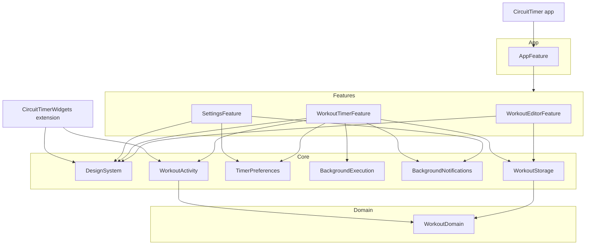

# CircuitTimer

[](https://github.com/akrementsov/CircuitTimer/actions/workflows/ci.yml)

An interval and circuit training timer for iPhone, in active development. A workout is a warm-up, a training block repeated for several rounds and a cool-down, each made of timed work and rest stages, with optional manual pauses in between. The domain, the timer engine, the workout list with its editor, stored in SwiftData, the Settings tab and a full-screen timer that plays a workout in the foreground are in place; the timer keeps its progress across backgrounding and relaunches; foreground tones, haptics and spoken stage names, plus background stage-start and finish notifications, are controlled by persistent Settings switches (see the roadmap).

The repository is also a showcase of how I build iOS apps: a small domain core with explicit contracts, TCA features on top, and tooling that keeps every commit green.

## Stack

- Swift 6 language mode with complete strict concurrency, iOS 17+
- SwiftUI and [The Composable Architecture](https://github.com/pointfreeco/swift-composable-architecture) 1.26 with the 2.0 deprecations trait enabled
- [swift-dependencies](https://github.com/pointfreeco/swift-dependencies) for every side effect
- Swift Testing; XCTest for the UI tests
- SwiftLint, GitHub Actions
- Xcode 27.1; tests run on the iOS 27.0 simulator

## Architecture

All code lives in one local Swift package, `CircuitTimerKit`. The Xcode project is a thin shell that launches `AppFeature`, configures TipKit and installs the injected notification presentation delegate before the UI starts.

The app and its widget extension are thin targets over the package's modules, which form four layers; a module imports only from the layers below it:



Not drawn, to keep the picture readable: `AppFeature`, the composition root, also imports `DesignSystem`, `WorkoutStorage`, `BackgroundExecution`, `BackgroundNotifications`, `TimerPreferences`, `WorkoutActivity` and `WorkoutDomain`; the editor and the timer also import `WorkoutDomain`. Also left out are `UITestContract`, which the features and the UI tests share, and the Debug-only `AppScenarios` above the features (see [UI tests](#ui-tests)). `Package.swift` is the exact list.

| Module | Layer | Responsibility |
|---|---|---|
| `AppFeature` | App | The root TCA feature: the tab bar with Workouts and Settings; the workout list with loading, empty and retryable error states; pushes the workout screen onto the Workouts stack, and on Start presents the timer full screen and returns the stack to the list under it. Before the first Start it requests notification permission. At launch it offers to continue or finish a saved run while separately cleaning notifications and ending Live Activities left by the previous process. |
| `WorkoutEditorFeature` | Features | The workout screen in the original app's cards: a saved workout opens read-only with Start workout at the bottom; the pencil edits a draft that the bottom Save workout button saves, back to read-only, or Back discards; a new workout starts with an empty stage in every section; stage durations typed as MM:SS on the number pad, and a dimmed Save that explains itself; stage editing within `WorkoutLimits`. |
| `WorkoutTimerFeature` | Features | The full-screen timer of the original app: a 3-2-1 countdown, the stage clock in League Gothic, progress by round, and the workout's stages on a screen of its own, opened from the timer while it pauses. Its clock loops catch wall-clock jumps against a monotonic clock, and the screen stays awake while it runs when Keep screen on is enabled. It plays generated cue tones, vibrates, and speaks stage names in the app language only while active and visible. It schedules stage-start and finish notifications for the background, in a bounded rolling window. It saves its run on every change of state; after the app was closed or killed, the list asks whether to continue it. It shows the run on the Lock Screen and in the Dynamic Island as a Live Activity, with a footnote when iOS refuses one. |
| `SettingsFeature` | Features | The Settings tab with persistent Sound, Vibration and Speak stage names, Background notifications and Keep screen on switches; notification permission status and a route to iOS Settings; its own navigation stack: About with the app version from an `AppVersionClient` dependency, and the legal pages. |
| `DesignSystem` | Core | Spacing, radius, size, typography and color tokens; clock text; the stage clock view in the bundled League Gothic; screen chrome; card rows, the caption plate and the bottom action panel; row swipe plaques and drag reorder with edge auto-scroll; the tab bar kept to the stacks' roots; the Live Activity's typography. Lint rejects literal styles anywhere else. |
| `WorkoutStorage` | Core | `WorkoutStorageClient`, a struct-of-closures dependency backed by SwiftData; in memory for previews. `WorkoutRunRecordClient`, the saved run as one JSON file. |
| `TimerPreferences` | Core | The Sound, Vibration, Speak names, Background notifications and Keep screen on toggles as `@Shared(.appStorage)` keys, shared by Settings and the timer. |
| `BackgroundExecution` | Core | `BackgroundTaskClient`: a background-task assertion around the run record writes of the timer and `AppFeature`. |
| `BackgroundNotifications` | Core | Injected local notification client, owner-scoped scheduling and cleanup, permission access, foreground suppression. |
| `WorkoutActivity` | Core | The Live Activity: a compact state of the run within iOS's 4 KB limit, what the Lock Screen and the Dynamic Island show for it, and `LiveActivityClient`, whose coordinator starts, updates and ends one activity per timer. The `CircuitTimerWidgets` extension draws it in the app's dark palette, with clocks that keep counting while the app sleeps. |
| `WorkoutDomain` | Domain | Workout model, normalization limits, the linear schedule and its fingerprint, and the `WorkoutRun` timer engine. Foundation and CryptoKit only, so the widget can use it. |
| `UITestContract` | Core | The accessibility identifiers the app and its UI tests share and, in Debug, the scenario names, launch keys and fixture names the tests read. No dependencies. |
| `AppScenarios` | App, Debug only | Each UI test scenario: its workouts and a value for every dependency the app reads, none of them live. The app builds its store from one when a UI test asks. |

Features never import each other, Core imports no feature, the domain imports none of our modules, and `Workout*` modules never import TCA or SwiftUI. The full set of conventions is in [AGENTS.md](AGENTS.md).

Foreground and background signal policy and the device checklist: [Timer signals](docs/timer-signals.md).

## The timer engine

`WorkoutRun` does not count ticks. It stores the schedule position reached at an anchor date and derives everything else from the time passed into each call:

- irregular or missed UI updates add no error; the position stays within about a millisecond of real time;
- after an hour in the background one call lands on the right stage — or on the first manual pause, which always waits for the user;
- every transition is a value-type mutation, so the whole contract is unit-testable without clocks or a UI.

The contract — a phase × operation table, nine invariants, the snapshot projection and the time rules — is written down in [docs/timer-engine.md](docs/timer-engine.md). Time is kept in whole milliseconds, and `TimeMath` is the only place that converts between `Date` and `Duration`.

### Clock changes

The engine works on wall-clock time because only a date survives an app restart and drives a Live Activity countdown.

- **Clock moved back:** the timer does not stall and committed progress is kept. If the clock goes back past the anchor the run re-anchors at the current time, and `rebase(at:keepingTotalElapsed:)` lets the UI restore the progress it has already shown.
- **Clock moved forward:** this is an accepted compromise. The run cannot tell it apart from time spent in the background, so it advances through timed stages up to the next manual pause.

## Getting started

```sh
open CircuitTimer.xcodeproj
```

Command line, with [SwiftLint](https://github.com/realm/SwiftLint) on `PATH` and `jq` available:

| Command | What it does |
|---|---|
| `make lint` | SwiftLint in strict mode and the scenario dependency check |
| `make test-scripts` | Tests of the scripts, the make targets around xcodebuild and the custom lint rules |
| `make test` | Builds and tests the package with warnings as errors |
| `make build-app` | Builds the app for the simulator |
| `make build-ui-tests` | Builds the app with its UI tests, as `make test-ui` does |
| `make test-ui` | Builds the app and runs its UI tests on `DESTINATION` |
| `make ci` | Everything CI runs |
| `make verify-clean` | Runs `make ci` on a fresh clone of `HEAD` |

## UI tests

The UI tests in `CircuitTimerUITests` drive the app with XCUITest. Each starts the app in a named scenario, a Debug-only state with its own data and no live dependencies, and works through Screens, one struct per screen, so a test reads as the user's steps:

```swift
@MainActor
final class WorkoutTimerUITests: XCTestCase {
    func test_oneWorkout_startThenFinish_returnsToList() {
        let app = launch(.oneWorkout)

        WorkoutListScreen(app)
            .assertHasWorkout(ScenarioFixture.workoutName, duration: "2 minutes")
            .openWorkout(ScenarioFixture.workoutName)
            .tapStart()
            .assertCurrentStage("Get ready, Starting in 3")
            .tapClose()
            .tap("No")
            .assertCurrentStage("Get ready, Starting in 3")
            .tapClose()
            .tap("Finish", landingOn: WorkoutListScreen.self)
            .assertHasWorkout(ScenarioFixture.workoutName)
    }
}
```

### How to add a UI test

1. **Scenario.** Use an existing case of `AppScenario` (`UITestContract`) or add one, with its workouts in `ScenarioWorkouts.swift` and its dependencies in `AppScenario.prepare` (`AppScenarios`). `make lint` fails when a dependency client, key or storage strategy is not set there, as long as a key's declaration keeps `DependencyKey` on its first line; that the value is not live is yours to check.
2. **Identifiers.** Give the elements the test needs an identifier from `AccessibilityID`, named `<screen>.<element>`; lint rejects any other. Text the user typed, such as a workout's name, and system elements, such as an alert's buttons, are found by their text.
3. **Screen.** Add actions and checks to the screen's struct in `CircuitTimerUITests/Screens/`, or a new struct that conforms to `Screen`. Queries stay private. Every action and check takes `file: StaticString = #filePath, line: UInt = #line` and passes them to the waits and to the next screen, so a failure points at the test's line. An action returns the screen the user lands on, which waits until it shows. A screen that returns to where it came from is generic, like `AlertScreen<Source>`; behavior several screens share goes into a protocol with a default implementation.
4. **Test.** In `<Area>UITests.swift`, a `@MainActor final class` with methods named `test_<start>_<action>_<expected>`, starting with `let app = launch(.<scenario>)`. Lint rejects `sleep`, waits in tests and `XCUIApplication()` outside `launch`; keep `setUp`, if any, synchronous.
5. **Parallel safety.** A test shares nothing with other tests and depends on no order: it launches its own app. Each launch already gets its own in-memory workouts and preferences, no record, notifications or Live Activity, its own clock and identifiers. TipKit's datastore on the simulator is shared; `launch` hides tips, so a test of a tip first adds a launch option that resets the datastore and shows them.
6. **Run.** `make test-ui` runs on `iPhone 17`; another simulator takes its own result bundle, log and DerivedData, for example `make test-ui DESTINATION='platform=iOS Simulator,name=iPhone 17 #2,OS=27.0'`. Runs on two simulators may overlap only after one run on each has finished alone; each first run is a cold build and its DerivedData takes several GB. `scripts/report-test-results.sh .build/TestResults/*.xcresult` prints failures, flaky tests and the slowest tests. More than one Xcode worker (`UI_TEST_WORKERS`) runs only on CI.
7. **Time stands still.** A scenario's clock never advances, so a started timer stays on its first countdown digit. The timer's logic is tested in the package with `TestStore` and `TestClock`.

## Releasing

1. For a new version, bump `MARKETING_VERSION` through a pull request. Wait for CI on `main` to pass.
2. Tag the commit `vX.Y.Z`, or `vX.Y.Z-rc.N` for another build of the same version, and push the tag.
3. The TestFlight workflow archives the app, signs it in the cloud with an App Store Connect API key and uploads it. The build is available once App Store Connect finishes processing it.

## Roadmap

- [x] **CT-1 Foundation** — package, domain model, schedule, timer engine, design tokens, root feature, lint and CI
- [x] **CT-8 Delivery** — TestFlight builds from GitHub Actions: a `v*` tag on `main` archives, signs in the cloud and uploads; the first build, 0.1.0, went through on 2026-10-14
- [x] **CT-2** — workout list and editor, SwiftData persistence
- [x] **CT-UI** — dark design of the original app, in slices:
  - [x] **CT-UI-1** — dark design tokens and the launch screen
  - [x] **CT-UI-2** — workout list after the original screen; the system navigation bar, Liquid Glass on iOS 26
  - [x] **CT-UI-3** — tab bar and the Settings tab with About and the legal pages
  - [x] **CT-UI-4** — the editor pushed onto the Workouts stack, with its own back button and no back gestures
  - [x] **CT-UI-5** — editor layout of the original app
  - [x] **CT-UI-6** — stage durations typed as MM:SS
  - [x] Swipe actions of the original app: the delete plaque on editor stages and on the list, duplicate on the list; own drag reorder (delivered with CT-3-2)
- [ ] **CT-QA** — tests through the UI, in slices:
  - [x] **CT-QA-1** — UI test architecture: Debug-only launch scenarios with no live dependencies, Screens, a shared test harness and CI step, and two tests that prove it
  - [ ] UI smoke tests of the main flows: the workout list, creating and editing, the timer, Settings
  - [ ] **CT-QA-2** — snapshot tests of the list and editor (dark only, English and Russian, Dynamic Type)
- [x] **CT-3** — the workout timer, in slices:
  - [x] **CT-3-1** — the timer in the foreground: full screen from the list, countdowns, clock-jump handling, the screen kept awake
  - [x] **CT-3-2** — the original start path: the workout screen and its Start workout button
  - [x] **CT-3-3** — background and restore
  - [x] **CT-3-4** — sound, haptics, spoken stage names and the Settings toggles
  - [x] **CT-3-5** — cues in the background through local notifications
- [ ] **CT-4** — Live Activity and Dynamic Island, in slices:
  - [x] **CT-4-1** — the running workout on the Lock Screen and in the Dynamic Island, and signing checks of both bundles on TestFlight
  - [ ] **CT-4-2** — pause and resume from the Live Activity
- [ ] **CT-5** — iCloud sync
- [ ] **CT-6** — in-app purchase with StoreKit 2
- [ ] **CT-7** — App Store release

## License

© Andrey Krementsov. All rights reserved. The code is published for review purposes only; no license to use, copy or distribute it is granted.
